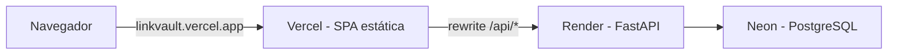

# LinkVault

## 1. Visão geral

**LinkVault** é uma aplicação web para salvar, organizar, pesquisar e compartilhar links da internet. A ideia é funcionar como uma biblioteca pessoal de referências, permitindo guardar artigos, tutoriais, documentações, vídeos, repositórios do GitHub e outros recursos relevantes.

O projeto tem como objetivo desenvolver uma aplicação útil no dia a dia, com complexidade moderada, que também sirva como projeto de portfólio para demonstrar conhecimentos em desenvolvimento full-stack, APIs REST, banco de dados relacional, autenticação, segurança, testes e containerização.

A aplicação deve permitir que usuários autenticados gerenciem suas próprias bibliotecas e compartilhem coleções publicamente por meio de URLs. Visitantes poderão acessar essas coleções sem criar uma conta, mas não poderão modificá-las.

## 2. Objetivos principais

- Desenvolver uma aplicação full-stack funcional.
- Implementar operações CRUD para links, coleções e tags.
- Implementar autenticação por e-mail e senha, com hash Argon2id e sessões mantidas no servidor.
- Permitir acesso público e somente para leitura às coleções compartilhadas.
- Implementar pesquisa, filtragem, ordenação e paginação de links.
- Garantir isolamento dos dados entre usuários, tanto na aplicação quanto nas restrições do banco de dados.
- Utilizar PostgreSQL como banco de dados relacional.
- Manter um contrato de API tipado de ponta a ponta (OpenAPI → TypeScript).
- Containerizar o ambiente com Docker e Docker Compose.
- Implementar testes automatizados e integração contínua.
- Disponibilizar uma demonstração pública gratuita, acessível a recrutadores sem fricção.
- Produzir documentação técnica clara, incluindo instruções para executar o projeto localmente.

## 3. Público e tipos de usuário

### 3.1. Visitante não autenticado

Um visitante deve poder:

- Abrir uma coleção pública por meio de sua URL.
- Visualizar os links presentes na coleção.
- Pesquisar links pelo título e pela descrição.
- Filtrar links por tags, quando disponíveis.
- Navegar pelos links e abrir os respectivos destinos.
- Criar uma conta ou entrar com uma conta de demonstração.

Um visitante não pode:

- Criar, editar ou excluir links.
- Modificar coleções ou tags.
- Acessar coleções privadas.
- Visualizar notas pessoais ou informações privadas do proprietário.

### 3.2. Usuário autenticado

Um usuário autenticado deve poder:

- Criar e acessar sua biblioteca pessoal.
- Cadastrar, visualizar, editar e excluir links.
- Criar, editar e excluir coleções.
- Organizar links em coleções.
- Criar e gerenciar tags.
- Adicionar notas pessoais aos links.
- Pesquisar, filtrar e ordenar sua biblioteca.
- Tornar coleções públicas ou privadas.
- Compartilhar coleções públicas por URL.
- Revogar o acesso público de uma coleção.
- Alterar sua senha.
- Encerrar sua sessão.

Cada usuário só pode gerenciar os próprios recursos. O fato de conhecer o identificador de um recurso pertencente a outra pessoa não deve conceder acesso a ele.

## 4. Autenticação por e-mail e senha

O MVP utilizará autenticação por e-mail e senha, com sessões mantidas no servidor. Essa escolha elimina a dependência de um provedor de e-mail no deploy de demonstração e permite que recrutadores testem a aplicação imediatamente.

A autenticação sem senha (Magic Link), a recuperação de senha e a verificação de e-mail foram adiadas para fases posteriores (ver seção 4.9). A arquitetura deverá ser preparada para recebê-las sem retrabalho.

### 4.1. Fluxo de cadastro

1. O usuário informa e-mail e senha na página de cadastro.
2. O frontend valida o formato dos campos (Zod) apenas para melhorar a experiência; a validação definitiva ocorre no backend (Pydantic).
3. O backend normaliza o e-mail (remoção de espaços e comparação case-insensitive).
4. O backend valida a política de senha (seção 4.3).
5. O backend gera o hash da senha com Argon2id e cria o usuário.
6. O backend cria uma sessão autenticada e envia o cookie de sessão ao navegador.

### 4.2. Fluxo de login

1. O usuário informa e-mail e senha.
2. O backend verifica o limite de tentativas (seção 4.7).
3. O backend busca o usuário pelo e-mail normalizado.
4. Se o usuário não existir, o backend executa a verificação contra um hash fictício, para que o tempo de resposta não revele quais e-mails estão cadastrados.
5. Em caso de falha, retornar uma mensagem genérica (“E-mail ou senha inválidos”).
6. Em caso de sucesso, se os parâmetros do Argon2 tiverem mudado (`check_needs_rehash`), o hash deverá ser atualizado de forma transparente.
7. O backend cria uma **nova** sessão (prevenindo fixação de sessão) e envia o cookie.

### 4.3. Armazenamento e política de senhas

- Utilizar **Argon2id** por meio da biblioteca `argon2-cffi`.
- Os parâmetros de custo (memória, iterações e paralelismo) deverão ser configuráveis por variável de ambiente. Como a instância gratuita de deploy possui pouca memória RAM, os valores padrão deverão seguir o perfil mínimo recomendado pela OWASP (`m=19 MiB`, `t=2`, `p=1`), evitando que logins simultâneos esgotem a memória do servidor.
- Comprimento mínimo de 12 caracteres (configurável). A NIST SP 800-63B rev. 4 recomenda 15 caracteres quando a senha é o único fator de autenticação; o valor adotado deverá ser documentado.
- Comprimento máximo de 128 caracteres, para evitar abuso computacional no hashing.
- Não impor regras arbitrárias de composição (símbolos, maiúsculas obrigatórias etc.).
- Rejeitar senhas presentes em uma lista local de senhas comuns, sem depender de serviços externos.
- Nunca registrar senhas, hashes ou corpos de requisição de autenticação em logs.

### 4.4. Requisitos de segurança da autenticação

- Mensagens de erro genéricas no login.
- Verificação com tempo constante, incluindo o caso de usuário inexistente.
- Limitação de tentativas por e-mail e por IP.
- Rotação da sessão a cada login.
- Revogação de todas as outras sessões do usuário ao alterar a senha.
- Alteração de senha exigindo a senha atual.
- Não armazenar tokens ou identificadores de sessão em `localStorage` ou `sessionStorage`.
- Proteger todas as rotas que exigem autenticação.
- Logout com invalidação da sessão no servidor.
- Políticas explícitas de expiração de sessão.

### 4.5. Sessões e cookies

A aplicação utilizará sessões mantidas no servidor, com implementação própria, em vez de JWT armazenado no navegador ou do cookie assinado padrão (que não pode ser revogado).

Funcionamento:

- No login, o backend gera um token opaco com `secrets.token_urlsafe(32)`.
- O token é enviado somente no cookie; no banco, armazena-se apenas o seu hash **SHA-256**. Como o token possui alta entropia, um hash rápido é suficiente (algoritmos lentos como Argon2 são necessários apenas para senhas).
- Cada requisição autenticada calcula o hash do cookie e busca a sessão correspondente, válida e não expirada.
- Expiração por inatividade (padrão: 7 dias) e expiração absoluta (padrão: 30 dias), ambas configuráveis.
- `last_seen_at` deverá ser atualizado no máximo a cada poucos minutos, evitando uma escrita no banco a cada requisição.
- Sessões expiradas deverão ser removidas de forma oportunista (por exemplo, durante o login), sem exigir jobs agendados no MVP.

O cookie de sessão deverá utilizar:

- `HttpOnly`, para impedir o acesso por JavaScript.
- `Secure` em produção.
- `SameSite=Lax`.
- `Path=/`.
- Prefixo `__Host-` em produção (exige `Secure`, `Path=/` e ausência de `Domain`).

O identificador de sessão não deverá ser exposto em respostas da API.

Frontend e backend deverão ser servidos sob a **mesma origem** em todos os ambientes: em desenvolvimento, por meio do proxy do Vite; em produção, por meio do rewrite do provedor do frontend (seção 11.3). Assim, o projeto não precisa de CORS nem de `SameSite=None`.

### 4.6. Proteção contra CSRF

Defesa em camadas:

1. `SameSite=Lax` no cookie de sessão.
2. Verificação do header `Origin` (ou `Referer`, como alternativa) em todas as requisições que alteram estado, aceitando apenas as origens configuradas.
3. Exigência de `Content-Type: application/json` nos endpoints de escrita.
4. **Synchronizer token:** ao criar a sessão, o backend gera um token CSRF associado a ela e o retorna no corpo das respostas de login e de `GET /api/auth/me`. O frontend mantém o token em memória e o envia no header `X-CSRF-Token`. O backend compara o valor com o da sessão em tempo constante.

Os endpoints de login e cadastro, que ainda não possuem sessão, são protegidos pelas camadas 1 a 3.

### 4.7. Limitação de tentativas (rate limiting)

A limitação será implementada no próprio PostgreSQL, sem Redis, para funcionar corretamente com múltiplos workers e instâncias.

- Uma tabela registra as tentativas por escopo (`login`, `register`, `demo`) e por chave (hash do e-mail normalizado ou do IP).
- Políticas iniciais (configuráveis):
    - Login: até 5 falhas por e-mail e 20 por IP a cada 15 minutos.
    - Cadastro: até 5 por IP por hora.
    - Conta demo: até 10 por IP por hora.
- Ao exceder o limite, responder `429 Too Many Requests` com o header `Retry-After`.
- Registros antigos deverão ser removidos de forma oportunista.
- O IP do cliente deverá ser obtido a partir dos headers de proxy confiáveis (`X-Forwarded-For`), considerando apenas os proxies conhecidos da infraestrutura.

O bloqueio por e-mail pode ser explorado para impedir temporariamente o login de outra pessoa. Por isso, a janela deverá ser curta e o trade-off deverá ser documentado.

### 4.8. Trade-offs aceitos no MVP

Os pontos abaixo são limitações conscientes e deverão ser registradas em um ADR:

- **Enumeração no cadastro:** sem verificação de e-mail, o cadastro precisa informar que um e-mail já está em uso.
- **E-mail não verificado:** é possível cadastrar um e-mail que não pertence ao usuário. O impacto é baixo enquanto não houver recuperação de senha nem envio de e-mails.
- **Sem recuperação de senha:** será implementada na fase 6.

### 4.9. Evolução planejada

Recuperação de senha, verificação de e-mail e Magic Link compartilham o mesmo mecanismo: um **token de uso único**, armazenado como hash, com expiração e consumido de forma atômica. Esses recursos serão implementados sobre uma tabela genérica (`one_time_tokens`, seção 7.8), criada quando a primeira dessas funcionalidades for desenvolvida.

O consumo do token deverá ser atômico:

```sql
UPDATE one_time_tokens
SET used_at = now()
WHERE token_hash = :hash
  AND purpose = :purpose
  AND used_at IS NULL
  AND expires_at > now()
RETURNING user_id;
```

Links enviados por e-mail deverão abrir uma página que exige uma ação explícita do usuário (`POST`) antes de consumir o token, evitando que scanners de e-mail o invalidem automaticamente.

### 4.10. Conta de demonstração

Para que recrutadores possam testar a aplicação sem criar uma conta, a landing page oferecerá o botão **Entrar como demo**, habilitado pela variável de ambiente `DEMO_MODE`.

- Cada clique cria um **usuário demo efêmero e isolado**, populado com links, coleções e tags de exemplo.
- Usuários demo expiram após 24 horas (configurável) e são removidos de forma oportunista, junto com todos os seus dados (exclusão em cascata).
- Usuários demo **não podem tornar coleções públicas**, evitando que o domínio da demonstração seja usado para hospedar conteúdo abusivo.
- Usuários demo não podem alterar a senha.
- A criação de contas demo é limitada por IP (seção 4.7).

Além disso, o seed de produção deverá incluir uma **coleção pública de exemplo**, linkada na landing page, para demonstrar o compartilhamento sem login.

## 5. Stack tecnológica definida

A implementação deverá utilizar as seguintes tecnologias. Cada escolha relevante deverá ser registrada em um ADR (`docs/adr/`).

### 5.1. Frontend

- **React** — construção da interface.
- **TypeScript** (modo `strict`) — tipagem estática.
- **Vite** — ambiente de desenvolvimento, build e proxy de desenvolvimento para a API.
- **React Router v7** (modo SPA) — roteamento entre páginas.
- **TanStack Query** — consultas, cache e sincronização com a API. Pesquisa, filtros e ordenação ficam na URL e fazem parte da `queryKey`.
- **openapi-typescript** e **openapi-fetch** — tipos e cliente HTTP gerados a partir do OpenAPI do backend, garantindo que frontend e backend não divirjam.
- **React Hook Form** — gerenciamento de formulários.
- **Zod** — validação de formulários no frontend. O contrato da API vem do OpenAPI; o Zod serve apenas para a experiência do usuário.
- **Radix UI Primitives** — componentes acessíveis e sem estilo (Dialog, DropdownMenu, Toast), compatíveis com CSS Modules.
- **CSS Modules** com design tokens em CSS custom properties — estilização modular.
- **Vitest** — testes unitários.
- **React Testing Library** — testes de componentes e interações.
- **MSW (Mock Service Worker)** — simulação da API na camada de rede durante os testes.
- **Playwright** — testes end-to-end.
- **ESLint** (com `typescript-eslint` e `eslint-plugin-jsx-a11y`) — análise estática e de acessibilidade.
- **pnpm** — gerenciador de pacotes.

### 5.2. Backend

- **Python 3.14** — linguagem principal do backend.
- **FastAPI** — framework da API REST, com OpenAPI nativo e injeção de dependências para autenticação e autorização.
- **Pydantic v2** — validação, serialização e contratos da API.
- **pydantic-settings** — configuração tipada por variáveis de ambiente.
- **SQLAlchemy 2.0** (estilo `Mapped[]`, modo síncrono) — ORM e acesso ao banco.
- **psycopg 3** — driver do PostgreSQL.
- **Alembic** — migrações do banco de dados.
- **argon2-cffi** — hash de senhas com Argon2id.
- **Uvicorn** — servidor ASGI, usando o gerenciador de processos próprio (`--workers`).
- **pytest** e **httpx** — testes automatizados.
- **Ruff** — lint e formatação.
- **mypy** — verificação estática de tipos (modo `strict` nos módulos de domínio).
- **uv** — gerenciamento de dependências e lockfile.

**Por que FastAPI:** maior demanda de mercado, OpenAPI nativo e preciso (base do contrato tipado com o frontend) e injeção de dependências que torna a autorização reutilizável e testável (`CurrentUser`, `get_owned_link`). Sessões, CSRF e rate limiting são implementados explicitamente, o que demonstra domínio sobre esses mecanismos.

**Por que SQLAlchemy síncrono:** a aplicação é limitada pelo banco, não pela CPU, e o FastAPI executa rotas síncronas em um threadpool. O modo assíncrono adicionaria complexidade (lazy loading proibido, testes mais complexos) sem ganho real nesta escala. Rotas futuras que façam I/O externo (como a busca de metadados de URLs) poderão usar `httpx` assíncrono de forma isolada.

### 5.3. Banco de dados

- **PostgreSQL 17** — banco de dados relacional.
- **`pg_trgm`** com índices **GIN** — pesquisa parcial e tolerante a pequenas diferenças em título e descrição, independente do idioma (adequada a referências técnicas, majoritariamente em inglês).
- Constraints, chaves estrangeiras compostas e índices para garantir integridade, isolamento e desempenho.

A pesquisa textual completa (`tsvector`) poderá ser avaliada no futuro, se a busca por trigramas se mostrar insuficiente.

### 5.4. Infraestrutura e qualidade

- **Docker** (imagens multi-stage, usuário não-root) — containerização.
- **Docker Compose** — ambiente de desenvolvimento.
- **GitHub Actions** — integração contínua.
- **Dependabot** — atualização de dependências.
- **Vercel** (plano Hobby) — hospedagem do frontend e proxy da API.
- **Render** (plano gratuito) — hospedagem do backend.
- **Neon** (plano gratuito) — PostgreSQL gerenciado.

### 5.5. Fora do escopo

Não utilizar no MVP: Kubernetes, microsserviços, Redis, filas (Celery, RQ), GraphQL, Next.js/SSR, Tailwind, bibliotecas prontas de autenticação ou provedores de identidade externos. Não introduzir Marshmallow, Flask ou bibliotecas equivalentes às já definidas. Toda nova dependência deverá resolver um problema concreto e ser justificada.

## 6. Funcionalidades do MVP

### 6.1. Autenticação

- Página de cadastro com e-mail e senha.
- Página de login.
- Botão de acesso com conta demo efêmera.
- Consulta da sessão atual.
- Alteração de senha, com revogação das demais sessões.
- Logout.
- Expiração e invalidação de sessões.
- Limitação de tentativas.
- Proteção das rotas privadas.

### 6.2. Gerenciamento de links

Cada link deverá conter, no mínimo:

- Identificador.
- Proprietário.
- URL.
- Título.
- Descrição opcional.
- Notas pessoais opcionais.
- Coleção opcional.
- Tags.
- Data de criação.
- Data da última atualização.

O usuário poderá cadastrar, consultar, editar e excluir links.

A URL deverá ser validada no backend: somente os esquemas `http` e `https` são aceitos, evitando XSS por meio de URLs `javascript:`, `data:` e similares. Todos os campos de texto deverão ter limites de tamanho. O sistema deve tratar entradas inválidas e impedir que um usuário manipule recursos pertencentes a outra conta.

### 6.3. Coleções

Cada usuário poderá criar coleções para organizar suas referências.

Uma coleção deverá possuir:

- Identificador.
- Proprietário.
- Nome.
- Descrição opcional.
- Visibilidade: pública ou privada.
- Slug público (somente quando pública).
- Data de criação.
- Data da última atualização.

O usuário poderá criar, editar, consultar e excluir coleções, além de associar links a elas. Cada link pertence a no máximo uma coleção (relação 1:N). Essa decisão deverá ser registrada em um ADR.

Excluir uma coleção **não** apaga os links: eles ficam sem coleção (`ON DELETE SET NULL`).

### 6.4. Compartilhamento público

Uma coleção pública deverá possuir uma URL compartilhável, por exemplo:

`/c/Xk3m9Qp2LwZr7A`

O slug deverá ser gerado com `secrets.token_urlsafe` e ter pelo menos 64 bits de entropia, evitando identificadores sequenciais ou enumeráveis. O slug não deverá conter o nome da coleção, para não expor seu conteúdo na URL.

Qualquer visitante que possuir o link poderá visualizar a coleção sem autenticação.

O proprietário poderá:

- Tornar a coleção pública.
- Torná-la privada.
- Copiar a URL pública.
- Revogar o acesso público.

Ao tornar uma coleção privada ou revogar o compartilhamento, o slug é descartado. Se a coleção for tornada pública novamente, um **novo** slug será gerado, de modo que URLs antigas nunca voltem a funcionar.

O compartilhamento público é baseado na posse do link, mas não deve ser tratado como uma garantia de confidencialidade. Informações que não podem ser expostas não devem fazer parte de coleções públicas.

### 6.5. Pesquisa, filtros e paginação

A aplicação deverá permitir pesquisar links pelo título e pela descrição, além de filtrar por coleção e tag.

A pesquisa deve funcionar tanto na biblioteca privada do proprietário quanto nas coleções públicas, respeitando as permissões de cada contexto.

A API utilizará **paginação por cursor (keyset)**:

- A resposta contém os itens e um `next_cursor` opaco (codificado em base64url) quando houver mais resultados.
- O cursor codifica o valor do critério de ordenação e o `id` do último item.
- Diferentemente da paginação por offset, a paginação por cursor não pula nem duplica itens quando links são criados ou excluídos durante a navegação.
- O cursor deverá ser validado; um cursor inválido ou incompatível com a ordenação atual resulta em `400`.

A pesquisa, os filtros, a ordenação e a paginação deverão funcionar em conjunto tanto na biblioteca privada quanto nas coleções públicas.

### 6.6. Tags

O usuário poderá criar tags e associá-las a vários links.

As tags deverão pertencer ao usuário, evitando colisões ou compartilhamento acidental de dados entre contas. Os nomes deverão ser únicos por usuário, sem diferenciar maiúsculas de minúsculas.

O modelo deverá permitir que um link possua várias tags e que uma tag esteja associada a vários links.

Para agilizar o uso, tags poderão ser criadas diretamente no formulário do link, além da tela de gerenciamento de tags.

### 6.7. Ordenação dos resultados

A aplicação deverá permitir que o usuário escolha como os links serão ordenados, tanto na biblioteca privada quanto nas coleções públicas.

#### Opções de ordenação

O MVP deverá oferecer:

- **Mais recentes:** links criados mais recentemente primeiro.
- **Mais antigos:** links criados há mais tempo primeiro.
- **Título (A–Z):** ordem alfabética crescente.
- **Título (Z–A):** ordem alfabética decrescente.
- **Última atualização:** links modificados mais recentemente primeiro.

A ordenação deverá funcionar em conjunto com a pesquisa, os filtros e a paginação. O usuário poderá, por exemplo, pesquisar links relacionados a Docker, filtrar por uma tag e ordenar os resultados por título.

#### Requisitos técnicos

- A ordenação deverá ser executada no backend, por meio de consultas SQLAlchemy.
- O frontend deverá enviar o critério escolhido como parâmetro da API.
- A API deverá aceitar somente valores de uma enumeração definida (`Literal`/`Enum` no Pydantic), evitando que parâmetros arbitrários sejam utilizados nas consultas.
- A ordenação deverá ser determinística: o `id` do link é sempre usado como critério de desempate.
- A ordenação por título não deverá diferenciar maiúsculas de minúsculas (por exemplo, `lower(title)` ou collation ICU), com índice correspondente.
- A ordenação deverá ser preservada durante a paginação.
- A interface deverá indicar claramente qual critério está selecionado.

Exemplo de requisição:

`GET /api/links?q=docker&tag=backend&sort=title_asc&limit=20&cursor=eyJ2IjoiZG9ja2VyIiwiaWQiOiIwMTkyLi4uIn0`

Os nomes exatos dos parâmetros poderão ser ajustados durante a implementação, desde que sejam consistentes em todos os endpoints relevantes.

## 7. Modelo de dados

O banco de dados deverá utilizar tabelas relacionais, chaves estrangeiras e constraints explícitas, definidas nas migrações do Alembic.

Os identificadores serão **UUIDv7**, gerados pela aplicação (`uuid.uuid7()`, Python 3.14). Eles não são enumeráveis, não revelam o volume de dados e mantêm boa localidade nos índices, por serem ordenados no tempo. Datas utilizam `timestamptz`.

### 7.1. users

- `id`
- `email` — único sem diferenciar maiúsculas de minúsculas (índice único em `lower(email)`).
- `password_hash`
- `name` — opcional.
- `is_demo` — padrão `false`.
- `expires_at` — opcional; preenchido apenas para usuários demo.
- `created_at`
- `updated_at`

Constraint: `CHECK (is_demo = (expires_at IS NOT NULL))`.

### 7.2. sessions

- `id`
- `user_id` — FK para `users`, `ON DELETE CASCADE`.
- `token_hash` — SHA-256 do token do cookie; único.
- `csrf_token_hash`
- `created_at`
- `last_seen_at`
- `idle_expires_at`
- `absolute_expires_at`
- `user_agent` — opcional, para futura tela de gerenciamento de sessões.

O token da sessão nunca é armazenado em texto puro.

### 7.3. auth_attempts

- `id`
- `scope` — `login`, `register` ou `demo`.
- `key_hash` — hash do e-mail normalizado ou do IP.
- `succeeded`
- `created_at`

Índice: `(scope, key_hash, created_at)`.

### 7.4. collections

- `id`
- `user_id` — FK para `users`, `ON DELETE CASCADE`.
- `name`
- `description`
- `visibility` — `private` ou `public`.
- `public_slug` — único quando presente.
- `created_at`
- `updated_at`

Constraints:

- `UNIQUE (id, user_id)` — necessária para as FKs compostas.
- `CHECK ((visibility = 'public') = (public_slug IS NOT NULL))` — impede estados inconsistentes.

### 7.5. links

- `id`
- `user_id` — FK para `users`, `ON DELETE CASCADE`.
- `collection_id` — opcional.
- `url`
- `title`
- `description` — opcional.
- `notes` — opcional e sempre privada.
- `created_at`
- `updated_at`

Constraints e índices:

- `UNIQUE (id, user_id)`.
- `FOREIGN KEY (collection_id, user_id) REFERENCES collections (id, user_id) ON DELETE SET NULL (collection_id)` — garante, **no banco**, que um link só possa pertencer a uma coleção do mesmo usuário. A sintaxe `SET NULL (coluna)` (PostgreSQL 15+) anula apenas `collection_id`, preservando `user_id`.
- `CHECK` de tamanho nos campos de texto.
- Índices GIN com `gin_trgm_ops` em `title` e `description`.
- Índices para as ordenações: `(user_id, created_at, id)`, `(user_id, updated_at, id)` e `(user_id, lower(title), id)`.

### 7.6. tags

- `id`
- `user_id` — FK para `users`, `ON DELETE CASCADE`.
- `name`
- `created_at`

Constraints:

- `UNIQUE (id, user_id)`.
- Índice único em `(user_id, lower(name))`.

### 7.7. link_tags

- `link_id`
- `tag_id`
- `user_id`

Constraints:

- `PRIMARY KEY (link_id, tag_id)`.
- `FOREIGN KEY (link_id, user_id) REFERENCES links (id, user_id) ON DELETE CASCADE`.
- `FOREIGN KEY (tag_id, user_id) REFERENCES tags (id, user_id) ON DELETE CASCADE`.

As FKs compostas impedem que um link seja associado à tag de outro usuário, mesmo que a camada de aplicação falhe.

### 7.8. one_time_tokens (pós-MVP)

Tabela prevista para recuperação de senha, verificação de e-mail e Magic Link (seção 4.9). Será criada na fase em que for necessária.

- `id`
- `user_id` — FK para `users`, `ON DELETE CASCADE`.
- `purpose` — `password_reset`, `email_verification` ou `magic_link`.
- `token_hash` — único.
- `expires_at`
- `used_at` — opcional.
- `created_at`

### 7.9. Princípio de isolamento

O isolamento entre usuários é garantido em duas camadas:

1. **Aplicação:** toda consulta privada é filtrada por `user_id`, por meio de dependências reutilizáveis do FastAPI.
2. **Banco de dados:** as FKs compostas impedem relações entre recursos de usuários diferentes.

## 8. API REST

A API seguirá o padrão REST, com documentação OpenAPI gerada automaticamente pelo FastAPI. Os nomes abaixo são uma proposta inicial e poderão ser ajustados para manter consistência.

### 8.1. Convenções

- Todas as rotas ficam sob o prefixo `/api`.
- Erros seguem o formato **Problem Details (RFC 9457)**, com `type`, `title`, `status`, `detail` e, em erros de validação, a lista de campos inválidos.
- Recursos inexistentes **ou pertencentes a outro usuário** retornam `404`, sem revelar sua existência.
- Listagens retornam `{ "items": [...], "next_cursor": "..." | null }`.
- A documentação interativa (`/api/docs`) deverá ficar disponível apenas em desenvolvimento ou por configuração explícita.

### 8.2. Autenticação

- `POST /api/auth/register` — cria uma conta e inicia a sessão.
- `POST /api/auth/login` — autentica e cria a sessão.
- `POST /api/auth/demo` — cria um usuário demo efêmero e inicia a sessão (disponível apenas com `DEMO_MODE` ativo).
- `GET /api/auth/me` — retorna os dados do usuário autenticado e o token CSRF.
- `POST /api/auth/password` — altera a senha e revoga as demais sessões.
- `POST /api/auth/logout` — encerra e invalida a sessão.

### 8.3. Links privados

- `GET /api/links` — lista links do usuário, com pesquisa, filtros, ordenação e paginação.
- `POST /api/links` — cria um link.
- `GET /api/links/{id}` — consulta um link.
- `PATCH /api/links/{id}` — atualiza um link.
- `DELETE /api/links/{id}` — exclui um link.

### 8.4. Coleções privadas

- `GET /api/collections` — lista coleções do usuário, com a quantidade de links.
- `POST /api/collections` — cria uma coleção.
- `GET /api/collections/{id}` — consulta uma coleção.
- `PATCH /api/collections/{id}` — atualiza nome e descrição.
- `DELETE /api/collections/{id}` — exclui uma coleção.
- `POST /api/collections/{id}/share` — torna a coleção pública e gera um novo slug.
- `DELETE /api/collections/{id}/share` — revoga o compartilhamento e descarta o slug.

A API nunca deverá permitir que um usuário altere a visibilidade de uma coleção pertencente a outra pessoa. Usuários demo recebem `403` ao tentar compartilhar.

### 8.5. Tags

- `GET /api/tags`
- `POST /api/tags`
- `PATCH /api/tags/{id}`
- `DELETE /api/tags/{id}`

### 8.6. API pública

- `GET /api/public/collections/{slug}` — retorna os dados públicos da coleção e as tags usadas nos seus links.
- `GET /api/public/collections/{slug}/links` — retorna os links públicos, com pesquisa, tags, ordenação e paginação.

Esses endpoints não exigirão autenticação, mas deverão verificar se a coleção existe e está pública. Caso contrário, retornam `404`.

As respostas públicas utilizam **schemas Pydantic próprios**, separados dos schemas privados, contendo somente os campos necessários à visualização. Não retornar notas pessoais, e-mails, identificadores de usuário ou tags que não pertençam aos links da coleção.

Não deve existir um endpoint público de escrita para coleções compartilhadas.

### 8.7. Saúde

- `GET /api/health` — indica que o processo está no ar (sem acessar o banco).
- `GET /api/ready` — verifica também a conexão com o banco de dados.

## 9. Segurança e autorização

A segurança deverá ser aplicada no backend. Ocultar botões na interface não é suficiente para proteger recursos.

Requisitos obrigatórios:

- Verificar autenticação em todos os endpoints privados, por meio de dependências do FastAPI.
- Verificar propriedade dos recursos em cada operação de leitura ou escrita.
- Reforçar o isolamento com FKs compostas no banco (seção 7.9).
- Validar todos os dados recebidos com Pydantic, incluindo limites de tamanho.
- Aceitar somente URLs `http` e `https`; no frontend, abrir links externos com `rel="noopener noreferrer"`.
- Utilizar SQLAlchemy de forma segura, sem concatenar entradas do usuário em consultas SQL.
- Implementar proteção CSRF em camadas (seção 4.6).
- Servir frontend e API sob a mesma origem, sem CORS.
- Utilizar cookies de sessão com atributos de segurança adequados.
- Enviar headers de segurança: `Content-Security-Policy`, `Strict-Transport-Security`, `X-Content-Type-Options: nosniff`, `Referrer-Policy` e `frame-ancestors 'none'`.
- Não expor senhas, tokens, segredos ou informações privadas em logs.
- Manter segredos e configurações sensíveis em variáveis de ambiente.
- Fornecer um arquivo `.env.example` sem credenciais reais.
- Aplicar limites de requisição nos endpoints de autenticação.
- Tratar erros sem expor stack traces ou detalhes internos em produção.
- Produzir logs estruturados com um identificador por requisição (`X-Request-ID`).

As ameaças consideradas e as mitigações adotadas deverão ser resumidas em `docs/THREAT_MODEL.md`.

Qualquer funcionalidade que busque automaticamente metadados de URLs deverá ser tratada com cuidado para evitar SSRF. O backend não poderá acessar endereços internos, serviços de metadados de nuvem ou endereços locais fornecidos pelo usuário. O DNS deverá ser resolvido e validado antes da conexão; redirecionamentos deverão ser revalidados; tempo limite e tamanho das respostas deverão ser controlados.

## 10. Organização do projeto

A aplicação deverá manter frontend e backend separados, com responsabilidades claras. O backend será organizado por domínio (feature), e não por camada técnica.

Uma estrutura inicial possível:

```
linkvault/
├── frontend/
│   ├── src/
│   │   ├── api/            # schema.d.ts gerado + cliente openapi-fetch
│   │   ├── components/     # componentes compartilhados
│   │   ├── features/       # auth, links, collections, tags, public
│   │   ├── pages/
│   │   ├── routes/
│   │   ├── lib/
│   │   └── styles/         # tokens e estilos globais
│   ├── tests/
│   │   └── e2e/
│   ├── Dockerfile
│   ├── vercel.json
│   └── package.json
├── backend/
│   ├── app/
│   │   ├── core/           # config, db, security, errors, logging
│   │   ├── auth/           # router, service, schemas, models, dependencies
│   │   ├── links/
│   │   ├── collections/
│   │   ├── tags/
│   │   ├── public/
│   │   ├── demo/           # criação e seed de usuários demo
│   │   └── main.py
│   ├── migrations/         # Alembic
│   ├── scripts/            # seed, export do OpenAPI
│   ├── tests/
│   ├── Dockerfile
│   ├── pyproject.toml
│   └── uv.lock
├── docs/
│   ├── adr/
│   └── THREAT_MODEL.md
├── .github/
│   ├── workflows/
│   └── dependabot.yml
├── docker-compose.yml
├── .env.example
├── README.md
└── .gitignore
```

Essa estrutura é uma referência, não uma obrigação rígida. A organização definitiva deverá evitar tanto um único arquivo excessivamente grande quanto a fragmentação desnecessária em muitos módulos.

## 11. Docker, ambientes e deploy

### 11.1. Ambiente de desenvolvimento

O projeto deverá utilizar Docker Compose para facilitar a execução em uma máquina nova, com os serviços:

- `db` — PostgreSQL 17, com volume persistente e health check.
- `api` — backend FastAPI com recarregamento automático.
- `web` — frontend Vite, com proxy de `/api` para o serviço `api` (mesma origem, sem CORS).

O ambiente deverá ser iniciado com um comando documentado:

`docker compose up --build`

O projeto também deverá incluir:

- Persistência dos dados do PostgreSQL em volume.
- Configuração por variáveis de ambiente, com `.env.example`.
- Migrações executáveis de forma documentada (`alembic upgrade head`).
- Script de seed com dados de exemplo.
- Health checks.
- Separação entre configurações de desenvolvimento e produção.
- Usuários e senhas de desenvolvimento claramente identificados como locais e não reutilizados em produção.

O uso de Docker não substitui a necessidade de documentar como executar os testes e aplicar migrações.

### 11.2. Imagens

- Dockerfiles multi-stage, com imagem final enxuta.
- Execução com usuário não-root.
- O container do backend aplica as migrações (`alembic upgrade head`) antes de iniciar o Uvicorn, pois o plano gratuito não oferece comandos de pré-deploy.

### 11.3. Deploy de demonstração (gratuito)

O deploy tem como objetivo exclusivo a demonstração do projeto e deverá utilizar somente planos gratuitos:

| Componente | Provedor | Plano |
|---|---|---|
| Frontend (build estático) e proxy da API | Vercel | Hobby (gratuito) |
| Backend (container Docker) | Render | Free Web Service |
| Banco de dados | Neon | Free |

Arquitetura:



O `vercel.json` deverá redirecionar `/api/*` para o backend no Render e as demais rotas para `index.html` (fallback da SPA). Como o navegador enxerga apenas a origem da Vercel, o cookie de sessão é de primeira parte, com `SameSite=Lax` e sem CORS.

Requisitos adicionais:

- Conexão com o Neon pela connection string com pooling, utilizando `pool_pre_ping=True` no SQLAlchemy, pois o banco encerra conexões ociosas ao suspender.
- O Uvicorn deverá aceitar headers de proxy apenas dos proxies confiáveis, para que o IP do cliente seja obtido corretamente.
- Secrets configurados nos painéis dos provedores, nunca versionados.

### 11.4. Limitações dos planos gratuitos e “cold start”

Os planos gratuitos suspendem os recursos após um período de inatividade. Na primeira requisição seguinte, ocorre um **cold start** (demora para “acordar”):

- **Render (backend):** o serviço é suspenso após cerca de 15 minutos sem tráfego. A primeira requisição seguinte pode levar **até cerca de um minuto** enquanto o container é reiniciado.
- **Neon (banco):** o compute é suspenso após alguns minutos de inatividade. A retomada costuma levar menos de um segundo a poucos segundos e se soma ao tempo do Render.
- **Vercel (frontend):** os arquivos estáticos são servidos por CDN e **não sofrem cold start**. A landing page carrega imediatamente, mesmo com o backend suspenso.

Os limites e tempos acima podem mudar e deverão ser conferidos na documentação dos provedores. O Render Free também possui uma cota mensal de horas de execução; manter o serviço artificialmente ativo com pings periódicos **não** será adotado.

Mitigações obrigatórias:

1. **Aquecimento antecipado:** ao carregar a landing page, o frontend dispara uma requisição a `GET /api/health`, de modo que o backend comece a iniciar enquanto o visitante lê a página.
2. **Aviso na interface:** se a API não responder em cerca de 3 segundos, exibir um aviso não bloqueante, como “Iniciando o servidor de demonstração, isso pode levar até um minuto…”, explicando que se trata de hospedagem gratuita.
3. **Retentativas:** as primeiras requisições deverão usar retentativas com backoff exponencial no TanStack Query, sem exibir erro enquanto o backend estiver iniciando.
4. **Timeouts compatíveis:** os timeouts do cliente HTTP deverão considerar o tempo de cold start. O limite de tempo do proxy da Vercel também deverá ser verificado.
5. **Documentação:** o README final deverá informar, ao lado do link da demo, que o primeiro acesso pode demorar.

Usuários demo e dados expirados são removidos de forma oportunista. Como o container é reiniciado com frequência, a limpeza também poderá ocorrer na inicialização da aplicação.

## 12. Testes automatizados

Adicionar testes para:

- Estados de carregamento, vazios e erros nas principais páginas.
- Feedback visual após operações de criação, edição e exclusão.
- Confirmações de ações destrutivas e alterações de visibilidade.
- Indicadores de coleções públicas e privadas.
- Comportamento responsivo das páginas principais.
- Ordenação crescente e decrescente dos resultados.
- Combinação de pesquisa, filtros, ordenação e paginação.
- Estabilidade da ordenação quando vários resultados possuem o mesmo título ou data.

### 12.1. Backend

Utilizar pytest e o `TestClient` (httpx) para testar:

- Cadastro, incluindo e-mail duplicado (case-insensitive) e política de senha.
- Login com credenciais válidas e inválidas, com mensagem genérica.
- Rehash transparente quando os parâmetros do Argon2 mudam.
- Rotação da sessão no login, logout e expiração (inatividade e absoluta).
- Alteração de senha com revogação das demais sessões.
- Proteção CSRF: ausência ou invalidade do token, `Origin` não permitida e `Content-Type` incorreto.
- Rate limiting e resposta `429` com `Retry-After`.
- Criação, isolamento, restrições e expiração de usuários demo.
- Acesso a rotas privadas sem autenticação.
- Isolamento de dados entre usuários, incluindo `404` para recursos de terceiros.
- Rejeição, **pelo banco**, de associações entre recursos de usuários diferentes (FKs compostas).
- CRUD de links, coleções e tags.
- Rejeição de URLs com esquemas não permitidos.
- Alternância entre coleções públicas e privadas, incluindo invalidação do slug antigo.
- Acesso público somente a coleções públicas.
- Ausência de campos privados nas respostas públicas.
- Pesquisa, filtros, ordenação e paginação por cursor, incluindo cursores inválidos.
- Validação de entradas inválidas e formato Problem Details.

Utilizar um **PostgreSQL real e isolado** (serviço do Compose localmente e service container no CI). Não utilizar SQLite, pois ele não reproduz constraints, collations nem `pg_trgm`. Cada teste deverá rodar em uma transação revertida ao final, garantindo isolamento e velocidade.

### 12.2. Frontend

Utilizar Vitest, React Testing Library e MSW para testar os principais componentes, formulários, estados de carregamento, erros (incluindo o aviso de cold start) e interações.

### 12.3. Teste end-to-end

Utilizar Playwright, executado contra o ambiente completo do Docker Compose, para implementar pelo menos os fluxos:

1. Cadastro, login e logout.
2. Abertura de uma coleção pública sem login.
3. Pesquisa ou filtragem de seus links.
4. Ausência de controles de edição para o visitante.
5. Rejeição de uma tentativa de escrita não autorizada pela API.

O teste deverá verificar também a autorização no backend, pois a ausência de botões não comprova a segurança do sistema.

## 13. Integração contínua

O GitHub Actions deverá executar verificações automáticas em pushes e pull requests, com jobs independentes:

- **Backend:** Ruff (lint e formatação), mypy e pytest com PostgreSQL como service container.
- **Frontend:** ESLint, `tsc --noEmit`, Vitest e build.
- **Contrato da API:** exporta o OpenAPI do backend, regenera os tipos do frontend e falha se houver diferença em relação aos arquivos versionados.
- **E2E:** Playwright contra o ambiente do Docker Compose.
- **Docker:** build das imagens.

O deploy é feito pelas integrações nativas da Vercel e do Render com o GitHub, a partir da branch principal, após o CI passar.

## 14. Roadmap de desenvolvimento

### Fase 1 — Fundação e deploy inicial

- Criar a estrutura do repositório.
- Configurar React, TypeScript, Vite e pnpm.
- Configurar FastAPI, uv, Ruff e mypy.
- Configurar SQLAlchemy, Alembic e PostgreSQL no Docker Compose.
- Implementar `/api/health` e `/api/ready`.
- Configurar o tratamento de erros (Problem Details) e os logs estruturados.
- Configurar o pipeline de CI básico.
- Configurar a geração de tipos a partir do OpenAPI.
- **Publicar o esqueleto na Vercel, no Render e no Neon**, validando o rewrite e o cold start desde o início.

### Fase 2 — Autenticação

- Implementar o modelo de usuários e sessões.
- Implementar cadastro e login com Argon2id.
- Implementar o cookie de sessão, a expiração e o logout.
- Implementar a proteção CSRF.
- Implementar o rate limiting no PostgreSQL.
- Implementar a alteração de senha.
- Implementar usuários demo efêmeros.
- Testar autenticação, autorização, CSRF e limites.

### Fase 3 — Biblioteca pessoal

- Implementar o CRUD de links, coleções e tags, com FKs compostas.
- Implementar a associação entre links, coleções e tags.
- Implementar validação, pesquisa (`pg_trgm`), ordenação e paginação por cursor.
- Construir a interface principal da biblioteca.
- Garantir e testar o isolamento entre usuários.

### Fase 4 — Compartilhamento público

- Implementar visibilidade pública e privada.
- Gerar slugs imprevisíveis, com invalidação ao revogar.
- Implementar endpoints públicos somente para leitura.
- Implementar a página pública da coleção, com pesquisa e filtros.
- Criar a coleção pública de exemplo no seed de produção.
- Testar o isolamento de informações privadas.

### Fase 5 — Qualidade e entrega

- Completar os testes do backend e do frontend.
- Criar os testes end-to-end com Playwright.
- Implementar as mitigações de cold start na interface.
- Revisar segurança, headers e tratamento de erros.
- Escrever os ADRs e o `THREAT_MODEL.md`.
- Melhorar responsividade e acessibilidade.
- Reescrever o README como apresentação do projeto e mover esta especificação para `docs/SPEC.md`.

### Fases pós-MVP

- **Fase 6 — Fluxos por e-mail:** recuperação de senha e verificação de e-mail com `one_time_tokens`, Mailpit em desenvolvimento e um provedor de e-mail em produção.
- **Fase 7 — Metadados de URL:** preenchimento automático de título e descrição, com proteção completa contra SSRF.
- **Fase 8 — Magic Link:** login sem senha como alternativa, reaproveitando a infraestrutura da fase 6.

Como estimativa inicial, o MVP pode ser organizado em aproximadamente quatro semanas, dependendo do tempo disponível. A autenticação, os testes e a integração entre os serviços podem exigir ajustes no cronograma.

## 15. Critérios de conclusão do MVP

O MVP será considerado concluído quando:

- A landing page apresentar claramente o propósito da aplicação e oferecer cadastro, login e acesso demo.
- A biblioteca e as páginas de coleções funcionarem em dispositivos móveis e desktops.
- Os estados de carregamento, vazio e erro estiverem implementados nas principais telas.
- A interface fornecer feedback após operações relevantes.
- Ações destrutivas e mudanças de visibilidade tiverem confirmações apropriadas.
- Coleções públicas e privadas possuírem indicadores visuais claros.
- Os resultados puderem ser ordenados por data, título e última atualização.
- A ordenação funcionar corretamente em conjunto com a pesquisa, os filtros e a paginação.
- Um usuário puder criar uma conta com e-mail e senha e entrar nela.
- Credenciais inválidas forem rejeitadas com mensagem genérica, e tentativas excessivas forem limitadas.
- Sessões puderem ser encerradas e expirarem conforme a política definida.
- O usuário puder criar, editar, consultar e excluir seus links.
- O usuário puder organizar links em coleções e tags.
- O usuário puder compartilhar uma coleção por URL e revogar o compartilhamento.
- Visitantes puderem acessar coleções públicas sem autenticação.
- Visitantes não puderem modificar coleções compartilhadas.
- Coleções privadas não puderem ser acessadas publicamente.
- Notas pessoais e outros campos privados não forem expostos.
- O sistema impedir que usuários acessem recursos de outras contas, inclusive no nível do banco.
- O contrato de API entre backend e frontend for verificado no CI.
- Os testes automatizados essenciais forem executados com sucesso.
- O ambiente puder ser iniciado usando Docker Compose.
- A demonstração pública estiver no ar, com conta demo e coleção pública de exemplo.
- O cold start for tratado na interface com aviso e retentativas.
- O README explicar instalação, configuração, testes e execução.

## 16. Funcionalidades futuras — fora do MVP

As funcionalidades abaixo podem ser consideradas após a conclusão da versão inicial:

- Recuperação de senha e verificação de e-mail.
- Login sem senha por Magic Link.
- Autenticação em dois fatores (TOTP).
- Tela de gerenciamento de sessões ativas.
- Extração automática de título, descrição e imagem de pré-visualização.
- Importação de favoritos do navegador via arquivo HTML.
- Exportação de dados para JSON ou CSV.
- Detecção de links duplicados.
- Verificação periódica de links quebrados.
- Extensão para navegador.
- Aplicação web progressiva (PWA).
- Sugestões automáticas de tags com IA.
- Catálogo global de coleções públicas.
- Descoberta e exploração de coleções públicas de outros usuários.
- Coleções aninhadas e recursos sociais.

Um catálogo global não faz parte do compartilhamento básico. No MVP, uma coleção pública só será acessível por meio de sua URL, sem necessariamente aparecer em uma listagem pública geral.

## 17. Interface e experiência do usuário (UI/UX)

A interface do LinkVault deverá priorizar clareza, organização e rapidez para salvar e recuperar referências. O projeto deve ser funcional tanto para usuários que acessam a biblioteca diariamente quanto para visitantes que abrem uma coleção compartilhada.

A interface deverá ter uma identidade visual consistente, hierarquia clara de informações e componentes reutilizáveis. Não é necessário criar uma interface visualmente complexa: a prioridade é tornar as ações principais fáceis de encontrar e entender.

### 17.1. Landing page

A aplicação deverá possuir uma página inicial pública que apresente o LinkVault antes de o usuário entrar na biblioteca.

A landing page deverá incluir:

- Nome e identidade visual do LinkVault.
- Uma descrição curta do problema que a aplicação resolve.
- Uma explicação visual ou textual de como salvar, organizar e compartilhar links.
- Destaque para o compartilhamento de coleções públicas, com link para a coleção pública de exemplo.
- Uma chamada principal para ação, como **Começar agora** ou **Acessar minha biblioteca**.
- Acesso às páginas de cadastro e login.
- O botão **Entrar como demo**, com uma breve explicação de que cria uma conta temporária com dados de exemplo.
- Uma alternativa para usuários que já possuem uma sessão ativa acessarem diretamente a biblioteca.
- O aviso de cold start, quando aplicável (seção 11.4).

A landing page não deverá exigir autenticação para ser visualizada e deverá carregar sem depender da API. Ao ser carregada, deverá disparar o aquecimento do backend.

A página inicial também deverá explicar, de forma breve, que coleções públicas podem ser visualizadas sem login.

### 17.2. Biblioteca pessoal

A área autenticada deverá funcionar como o painel principal do usuário.

Ela deverá incluir:

- Navegação para a biblioteca, coleções e tags.
- Campo de pesquisa.
- Controles de filtro e ordenação.
- Lista ou grade de links.
- Acesso rápido para adicionar um link.
- Indicadores de coleção e tags associadas a cada link.
- Ações para editar e excluir links.
- Acesso às configurações de visibilidade das coleções.
- Acesso à alteração de senha.
- Opção de logout.
- Um indicador discreto quando a sessão for de uma conta demo, informando sua expiração.

A organização visual deverá facilitar a identificação do título, domínio, descrição e data de criação ou atualização do link. Notas pessoais poderão aparecer na visualização privada, mas nunca em uma página pública.

### 17.3. Página de coleções

A página de coleções deverá permitir que o usuário visualize e gerencie suas coleções.

Cada coleção deverá exibir seu nome, descrição opcional, quantidade de links e estado de visibilidade.

As ações principais deverão incluir:

- Criar uma coleção.
- Editar nome e descrição.
- Abrir a coleção.
- Alterar a visibilidade entre pública e privada.
- Copiar o link de compartilhamento, quando público.
- Revogar o compartilhamento.
- Excluir a coleção, após confirmação.

A interface deverá deixar claro que tornar uma coleção pública permite que qualquer pessoa com o link visualize seu conteúdo. Torná-la privada deverá interromper o acesso público, e um novo compartilhamento gerará uma nova URL.

Para usuários demo, a opção de tornar uma coleção pública deverá aparecer desabilitada, com uma explicação.

### 17.4. Página pública de uma coleção

Uma coleção pública deverá possuir uma página própria acessível sem login.

Essa página deverá apresentar:

- Nome da coleção.
- Descrição, se existente.
- Links pertencentes à coleção.
- Pesquisa e filtros disponíveis.
- Controles de ordenação.
- Um indicador de que a coleção é pública.
- Uma opção para voltar à landing page ou conhecer o LinkVault.

A interface pública deverá ser somente para leitura. Não deverá exibir botões de edição, exclusão ou gerenciamento da coleção.

A ausência desses controles é apenas uma decisão de interface: o backend continuará responsável por impedir qualquer operação não autorizada.

Caso uma coleção deixe de ser pública, a página deverá apresentar uma mensagem adequada de indisponibilidade, sem revelar informações privadas sobre o proprietário.

### 17.5. Indicadores visuais de visibilidade

O estado público ou privado de uma coleção deverá ser visível sem que o usuário precise abrir suas configurações.

Utilizar indicadores textuais e visuais consistentes, por exemplo:

- **Pública:** ícone de compartilhamento ou globo acompanhado do texto “Pública”.
- **Privada:** ícone de cadeado acompanhado do texto “Privada”.

Não depender exclusivamente da cor para diferenciar os estados. Os indicadores deverão ter contraste suficiente, ser compreensíveis e funcionar com tecnologias assistivas.

A página de gerenciamento de coleções também deverá explicar o efeito de cada estado.

Quando uma coleção for pública, a interface deverá facilitar a cópia da URL compartilhável e informar quando o compartilhamento for revogado.

### 17.6. Responsividade

A aplicação deverá funcionar adequadamente em computadores, tablets e celulares.

Requisitos:

- Utilizar layout responsivo, adaptando navegação, listas, formulários e menus ao espaço disponível.
- Evitar rolagem horizontal da página em tamanhos de tela comuns.
- Manter os controles principais acessíveis em telas pequenas.
- Adaptar listas ou grades de links para uma apresentação legível em dispositivos móveis.
- Garantir que formulários e diálogos não ultrapassem os limites da tela.
- Permitir que botões e elementos interativos sejam utilizados por toque.
- Manter textos legíveis, espaçamentos adequados e áreas de interação confortáveis.
- Garantir que a página pública de uma coleção tenha a mesma atenção à responsividade que a biblioteca privada.

A implementação deverá ser validada em larguras de tela representativas de dispositivos móveis, tablets e desktops.

### 17.7. Estados de carregamento

Todas as páginas e operações que dependam da API deverão fornecer feedback visual durante o carregamento.

Exemplos:

- Skeletons ou placeholders para listas de links e coleções.
- Indicador de carregamento ao entrar, cadastrar ou criar uma conta demo.
- Estado de processamento ao salvar ou editar um link.
- Feedback ao alterar a visibilidade de uma coleção.
- Indicador de carregamento durante pesquisa e troca de página.
- Aviso de cold start quando o backend demorar a responder (seção 11.4).

Enquanto uma operação estiver em andamento, evitar envios duplicados acidentais. Quando apropriado, desabilitar temporariamente o controle utilizado e apresentar um texto de ação em andamento.

Os estados de carregamento não deverão bloquear a navegação inteira sem necessidade.

### 17.8. Estados vazios

A interface deverá diferenciar uma biblioteca vazia de uma pesquisa sem resultados.

Exemplos:

- **Biblioteca vazia:** explicar que o usuário ainda não salvou links e oferecer um botão para adicionar o primeiro.
- **Coleção vazia:** informar que a coleção ainda não contém links e oferecer uma ação para adicionar um.
- **Nenhum resultado de pesquisa:** informar que nenhum link corresponde à pesquisa atual e permitir limpar os filtros.
- **Nenhuma coleção criada:** incentivar a criação da primeira coleção.
- **Nenhuma tag criada:** explicar brevemente como tags ajudam a organizar referências.

Os estados vazios deverão oferecer orientação útil e, quando possível, uma ação que ajude o usuário a continuar.

### 17.9. Estados de erro

Erros da API, falhas de conexão e erros de validação deverão ser tratados com mensagens compreensíveis.

A aplicação deverá considerar, entre outros:

- Falha ao carregar links ou coleções.
- Erro ao salvar ou editar um link.
- URL inválida.
- Credenciais inválidas.
- E-mail já cadastrado ou senha fora da política.
- Excesso de tentativas (`429`), informando quando será possível tentar novamente.
- Sessão expirada, redirecionando ao login e preservando a página de destino.
- Coleção inexistente, privada ou cujo compartilhamento foi revogado.
- Backend iniciando (cold start), diferenciado de uma falha real.
- Erros de rede e indisponibilidade temporária do backend.

Sempre que possível, oferecer uma ação para tentar novamente ou corrigir a entrada.

Não exibir stack traces, detalhes internos do servidor ou informações sensíveis ao usuário. Os erros de validação deverão indicar o campo que precisa ser corrigido, a partir das informações do Problem Details.

A aplicação deverá distinguir entre erros recuperáveis e operações que falharam definitivamente.

### 17.10. Confirmações e feedback de ações

Ações importantes deverão fornecer feedback claro para que o usuário saiba se foram concluídas.

Exemplos:

- Conta criada.
- Senha alterada.
- Link criado com sucesso.
- Link atualizado com sucesso.
- Link excluído.
- Coleção criada ou atualizada.
- URL pública copiada.
- Compartilhamento habilitado ou revogado.
- Sessão encerrada.

Utilizar notificações discretas, como toasts, mensagens próximas ao formulário ou feedback inline, conforme o contexto.

Operações destrutivas ou que alterem significativamente a privacidade deverão exigir confirmação explícita.

Exemplos:

- Excluir um link.
- Excluir uma coleção.
- Tornar uma coleção pública.
- Tornar uma coleção privada ou revogar seu compartilhamento.

As confirmações de visibilidade deverão explicar a consequência da ação. Por exemplo, antes de tornar uma coleção pública, informar que qualquer pessoa com o link poderá visualizar seu conteúdo.

Não exigir confirmação para toda ação simples. A experiência deverá evitar diálogos excessivos que atrapalhem o fluxo de uso.

### 17.11. Acessibilidade

A interface deverá seguir boas práticas básicas de acessibilidade:

- Utilizar elementos HTML semânticos.
- Garantir navegação por teclado.
- Fornecer rótulos acessíveis para campos e botões.
- Manter contraste adequado entre texto e fundo.
- Não depender somente de cores para comunicar estados.
- Exibir mensagens de erro associadas aos campos correspondentes.
- Garantir foco visível e comportamento adequado de diálogos (Radix UI).
- Utilizar textos compreensíveis para ícones e ações.
- Anunciar avisos dinâmicos, como toasts e o aviso de cold start, por meio de regiões `aria-live`.

A acessibilidade deverá ser considerada durante a implementação dos componentes, e não somente ao final do projeto.

### 17.12. Consistência da interface

Os componentes reutilizáveis deverão manter padrões visuais e comportamentais consistentes para botões, campos, menus, cartões, notificações, indicadores de visibilidade e diálogos.

A interface deverá priorizar CSS Modules, conforme a stack definida, com design tokens centralizados, evitando estilos duplicados e regras excessivamente específicas.

A arquitetura de frontend deverá separar páginas, componentes compartilhados, funcionalidades, acesso à API e lógica de estado.

A experiência deverá continuar simples e previsível, sem adicionar animações ou efeitos visuais que prejudiquem a usabilidade ou o desempenho.

## 18. Resultado esperado

Ao final, o LinkVault deverá ser uma aplicação web full-stack funcional, containerizada, documentada e publicada em uma demonstração gratuita, na qual usuários possam gerenciar uma biblioteca pessoal de links com autenticação segura por e-mail e senha e compartilhar coleções com outras pessoas.

O projeto deve demonstrar domínio prático de React, TypeScript, Python, FastAPI, APIs REST com contrato tipado, PostgreSQL, autenticação baseada em sessões, segurança, testes automatizados, Docker e integração contínua.

O foco é entregar um MVP coeso, seguro, utilizável e fácil de demonstrar, em vez de acumular funcionalidades avançadas antes que os requisitos fundamentais estejam concluídos.